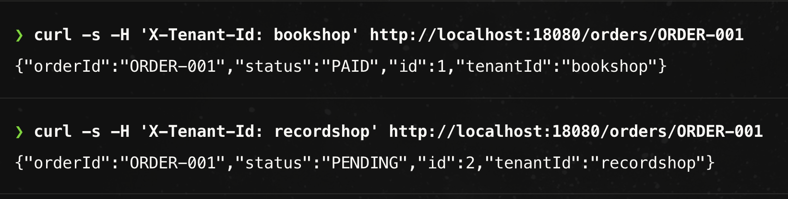
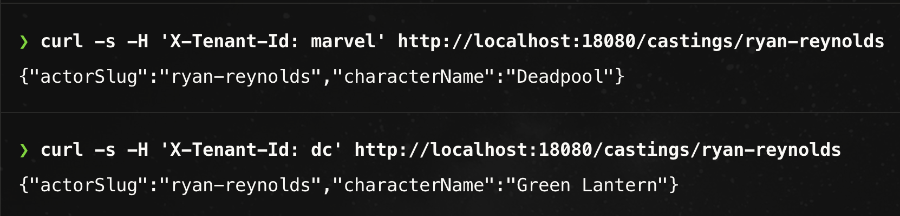
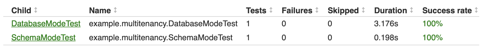

# Spring Boot와 JPA로 시작하는 데이터베이스 멀티테넌시

여러 고객사(테넌트)의 데이터를 하나의 테이블에서 관리하다 보면, Repository 메서드에 테넌트 조건이 반복해서 등장합니다.

```java
interface OrderRepository extends JpaRepository<Order, Long> {
    Optional<Order> findByOrderIdAndTenantId(String orderId, String tenantId);
    List<Order> findAllByStatusAndTenantId(String status, String tenantId);
    long countByStatusAndTenantId(String status, String tenantId);
}
```

문제는 중복만이 아닙니다. 테넌트 조건을 빠뜨리면 다른 고객사의 데이터가 조회될 수 있습니다. 수정·삭제 쿼리라면 다른 고객사의 데이터를 바꾸거나 지울 수도 있습니다.

이 글에서는 JPA 구현체인 Hibernate로 테넌트 조건을 자동 적용하는 방법과, 스키마·DB를 나누어 연결 대상을 선택하는 방법을 간단한 예제로 살펴봅니다.

> **예제 환경**
>
> Java 25 · Spring Boot 4.1.1 · Hibernate ORM 7.4.5.Final · PostgreSQL 17
>
> Spring Data JPA 등 의존성은 Spring Boot가 관리하는 버전을 사용했습니다.
>
> 본문에는 동기 요청의 테넌트별 조회 흐름을 설명하는 데 필요한 코드만 실었습니다.

## 테넌트와 세 가지 데이터 분리 방식

멀티테넌시는 여러 고객이 하나의 시스템을 공유하는 아키텍처입니다. 이때 고객사나 조직처럼 서비스 안에서 독립적으로 구분해 관리하는 고객 단위를 **테넌트**라고 합니다.

관계형 DB에서 테넌트별 데이터를 나누는 대표적인 방식은 행 분리, 스키마 분리, DB 분리입니다.[^hibernate] 스키마는 DB 안에서 테이블 등의 객체를 묶는 네임스페이스를 뜻합니다.


*테넌트 데이터를 행·스키마·DB 단위로 나눈 모습*

| 방식                             | 데이터 배치                    | 조회 범위를 정하는 지점             |
| ------------------------------ | ------------------------- | ------------------------- |
| 행 분리 (Discriminator column) | 같은 테이블에 여러 테넌트의 데이터를 저장   | SQL의 테넌트 조건 (`tenant_id`) |
| 스키마 분리 (Schema per tenant)     | 같은 DB 안의 테넌트별 스키마에 테이블 구성 | 커넥션에서 사용할 스키마             |
| DB 분리 (Database per tenant)    | 테넌트별 DB에 테이블 구성           | 커넥션을 얻을 DataSource        |

## 행 분리: `@TenantId`로 반복되는 조건 줄이기

행 분리에서는 Hibernate의 `@TenantId`나 DB의 행 수준 보안(RLS) 정책 등으로 테넌트 조건을 자동 적용할 수 있습니다.[^hibernate][^postgres]

이번 글에서는 Hibernate의 `@TenantId`를 사용합니다. 테넌트 ID를 담는 엔티티 필드를 표시하는 어노테이션으로, `Order` 엔티티의 `tenantId` 필드에 이 어노테이션을 추가합니다.[^tenant-id]

```java
@Entity
@Table(name = "orders", uniqueConstraints =
        @UniqueConstraint(columnNames = {"tenant_id", "order_id"}))
public class Order {
    @Id
    @GeneratedValue(strategy = GenerationType.IDENTITY)
    private Long id; // 테이블의 기본 키

    @TenantId
    @Column(name = "tenant_id", nullable = false, updatable = false)
    private String tenantId;

    @Column(name = "order_id", nullable = false)
    private String orderId; // 서로 다른 테넌트에서 같은 값 사용 가능

    @Column(name = "status", nullable = false)
    private String status;
}
```

Hibernate는 세션의 테넌트 ID를 조회 조건에 사용하고, 새 엔티티를 저장할 때도 이 ID를 `tenantId` 필드에 채웁니다.[^hibernate]

따라서 Repository 메서드에 테넌트 ID를 인자로 전달하지 않아도 됩니다.

```java
interface OrderRepository extends JpaRepository<Order, Long> {
    Optional<Order> findByOrderId(String orderId);
    List<Order> findAllByStatus(String status);
    long countByStatus(String status);
}
```

`findByOrderId()`를 호출하면 Hibernate가 생성하는 SQL에는 `order_id`와 `tenant_id` 조건이 함께 들어갑니다.

```sql
select ...
from orders
where tenant_id = ? and order_id = ?
```

> [!warning] 네이티브 SQL의 테넌트 조건
> `@Query(nativeQuery = true)` 등으로 실행하는 네이티브 SQL에는 `@TenantId`의 테넌트 조건이 자동으로 적용되지 않습니다.

## 요청의 테넌트를 Hibernate 세션에 전달

Hibernate는 JPA의 `EntityManager`를 통한 작업을 `Session`에서 처리합니다. 세션을 열 때 테넌트 ID를 받아, 그 테넌트의 데이터를 조회하거나 저장합니다.[^hibernate]

세 가지 분리 방식 모두 테넌트 ID를 세션에 전달하는 과정은 같습니다.

> 요청에서 테넌트 ID 식별 → 요청 처리 범위에 바인딩 → 새 세션을 여는 과정에서 바인딩된 테넌트 ID 확인 → 그 테넌트의 데이터 조회

### 세션이 열리는 시점

Spring Boot는 요청 전체에 `EntityManager`를 유지하는 OSIV 옵션을 기본으로 켭니다.[^transactions] 예제에서는 이 옵션을 끄고 세션의 생명주기를 서비스 트랜잭션에 맞췄습니다. 기존 트랜잭션 없이 Spring 서비스 빈의 `@Transactional` 메서드를 호출하면 새 세션이 열리므로, 호출 전에 테넌트 ID를 바인딩해야 합니다.[^transactions]

```yaml
# application.yaml
spring:
  jpa:
    open-in-view: false  # 요청 전체에 세션을 유지하지 않음
```

### 요청 처리 범위에 테넌트 ID 바인딩

요청에서 읽은 테넌트 ID를 바인딩해 두면, 그 범위 안에서 호출되는 서비스나 Repository도 같은 값을 읽을 수 있습니다. 메서드마다 테넌트 ID를 인자로 전달하지 않아도 됩니다.

이런 값은 흔히 `ThreadLocal`에 두지만, 예제에서는 Java 25에서 정식 기능이 된 `ScopedValue`를 사용했습니다.[^scoped-value] `ScopedValue`는 바인딩한 값을 범위 안에서 변경할 수 없고, 실행 범위가 끝나면 바인딩이 자동으로 해제됩니다. 따라서 필터에서 정한 테넌트 ID를 이후 코드에서 읽기만 하는 이 예제에 잘 맞습니다. 두 API의 차이는 부록에 정리했습니다.

```java
public final class TenantContext {
    private static final ScopedValue<String> CURRENT = ScopedValue.newInstance();

    public static <T> T call(String tenant, Supplier<T> work) {
        return ScopedValue.where(CURRENT, tenant).call(work::get);
    }

    public static <T, X extends Throwable> T callChecked(
        String tenant, ScopedValue.CallableOp<T, X> work
    ) throws X {
        return ScopedValue.where(CURRENT, tenant).call(work);
    }

    public static String required() {
        return CURRENT.orElseThrow(
                () -> new IllegalStateException("No tenant is bound"));
    }
}
```

`call()`과 `callChecked()`는 테넌트 ID를 바인딩한 범위에서 작업을 실행하고, `required()`는 그 범위의 테넌트 ID를 읽습니다.

`TenantFilter`는 헤더에서 읽은 테넌트 ID를 바인딩하고, 그 범위 안에서 필터 체인을 실행합니다.

```java
public class TenantFilter extends OncePerRequestFilter {
    @Override
    protected void doFilterInternal(
            HttpServletRequest request,
            HttpServletResponse response,
            FilterChain chain) throws IOException, ServletException {
        // 헤더 검증과 필터 체인의 예외 처리는 생략
        String tenant = request.getHeader("X-Tenant-Id");

        TenantContext.callChecked(tenant, () -> {
            chain.doFilter(request, response);
            return null;
        });
    }
}
```

> [!note] 예제의 테넌트 식별
> 예제에서는 조회 흐름을 간단히 확인할 수 있도록 `X-Tenant-Id` 헤더에서 테넌트 ID를 직접 읽습니다. 테넌트 식별 방식의 설계는 이 글에서 다루지 않습니다.

### `TenantResolver`로 테넌트 ID 제공

Hibernate는 `CurrentTenantIdentifierResolver`로 세션에 사용할 테넌트 ID를 얻습니다.[^hibernate] 예제의 `TenantResolver`는 `TenantContext`에서 ID를 읽고, 설정에 등록된 테넌트인지 확인한 뒤 반환합니다.

```java
public class TenantResolver implements CurrentTenantIdentifierResolver<String> {
    private final TenantProperties tenants;  // 등록된 테넌트 설정

    @Override
    public String resolveCurrentTenantIdentifier() {
        String tenant = TenantContext.required();
        if (!tenants.knows(tenant)) {
            throw new IllegalArgumentException("Unknown tenant: " + tenant);
        }
        return tenant;
    }
}
```

`TenantResolver`를 Spring Boot의 `HibernatePropertiesCustomizer`로 Hibernate에 등록합니다.

```java
@Configuration
public class TenantConfiguration {
    @Bean
    HibernatePropertiesCustomizer tenantIdentity(TenantResolver resolver) {
        return properties -> properties.put(
                MultiTenancySettings.MULTI_TENANT_IDENTIFIER_RESOLVER,
                resolver
        );
    }
}
```

세션은 `TenantResolver`가 반환한 테넌트 ID를 유지합니다. 행 분리에서는 이 ID를 SQL 조건에 사용하고, 스키마·DB 분리에서는 커넥션이 사용할 스키마나 DataSource를 선택하는 데 사용합니다.

## 행 분리 조회 결과 확인

앞의 주문 예제에서 서점(`bookshop`)과 음반점(`recordshop`)을 각각 하나의 테넌트로 두고, 같은 주문 ID로 상태가 다른 주문을 준비했습니다. `X-Tenant-Id` 헤더만 바꿔 같은 주문을 조회합니다.



*테넌트별 주문 조회 결과*

같은 주문 ID로 조회해도, 헤더에 지정한 테넌트의 주문만 반환됩니다.

## 스키마·DB 분리의 공통 예제

`@TenantId`를 적용해도 여러 테넌트의 데이터는 같은 테이블에 저장됩니다. 이번에는 테넌트마다 테이블을 따로 두는 스키마 분리와 DB 분리를 비교하겠습니다.[^azure-patterns]

### 같은 배우, 서로 다른 배역

Ryan Reynolds의 배역은 Marvel에서는 `Deadpool`, DC에서는 `Green Lantern`입니다. 이 예제에서는 Marvel과 DC를 테넌트로 삼고, 테넌트마다 배우별 배역을 하나씩 저장합니다. 배우 ID인 `actorSlug`를 테이블의 기본 키로 사용합니다.

| 세계관(테넌트) | 배우 ID (`actorSlug`) | 배역 (`characterName`) |
| --- | --- | --- |
| Marvel (`marvel`) | `ryan-reynolds` | Deadpool |
| DC (`dc`) | `ryan-reynolds` | Green Lantern |

스키마 분리와 DB 분리는 같은 엔티티·Repository·서비스 코드를 사용합니다.

```java
// Casting.java
@Entity
@Table(name = "casting")
public class Casting {
    @Id
    @Column(name = "actor_slug")
    private String actorSlug;
    @Column(name = "character_name")
    private String characterName;
}

// CastingRepository.java
public interface CastingRepository extends JpaRepository<Casting, String> {}
```

```java
@Service
public class CastingService {
    private final CastingRepository castingRepository;

    @Transactional(readOnly = true)
    public Casting findByActor(String actorSlug) {
        return castingRepository.findById(actorSlug)
                .orElseThrow(() -> new ResponseStatusException(HttpStatus.NOT_FOUND));
    }
}
```

조회 코드에는 테넌트 ID를 전달하거나 테넌트 조건을 지정하는 부분이 없습니다. 두 방식의 차이는 비즈니스 코드가 아니라 테넌트에 맞는 스키마나 DataSource를 선택하는 부분에 있습니다.

예제에서는 `schema`·`database` 프로파일로 각각의 설정 파일을 불러오고, 파일에 지정한 `demo.strategy` 값으로 사용할 구현을 선택합니다.


*테넌트 식별부터 스키마·DB 선택까지의 요청 처리 흐름*

## 스키마 분리: 같은 DB에서 사용할 스키마 선택

스키마 분리에서는 하나의 DataSource로 `shared` DB에 연결하고, 테넌트에 따라 사용할 스키마를 바꿉니다.

설정 파일에 테넌트 ID별로 사용할 스키마 이름을 지정합니다.

```yaml
# application-schema.yaml
demo:
  strategy: SCHEMA
  schema:
    url: jdbc:postgresql://localhost:55432/shared
    tenants:  # 테넌트 ID → 스키마 이름
      marvel: marvel_schema
      dc: dc_schema
```

`TenantSchemaMapper`는 세션의 테넌트 ID에 맞는 스키마 이름을 반환합니다. 예제에서는 `demo.schema.tenants`에서 스키마 이름을 찾습니다.[^schema]

```java
@Configuration
public class TenantConfiguration {
    @Configuration
    @ConditionalOnProperty(
            prefix = "demo", name = "strategy", havingValue = "SCHEMA")
    static class Schema {
        @Bean
        TenantSchemaMapper<String> schemaMapper(TenantProperties properties) {
            return tenant -> {
                String schema = properties.schema().tenants().get(tenant);
                if (schema == null) {
                    throw new IllegalArgumentException("Unknown tenant: " + tenant);
                }
                return schema;
            };
        }

        @Bean
        HibernatePropertiesCustomizer schemaRouting(TenantSchemaMapper<String> mapper) {
            return properties -> properties.put(
                    MultiTenancySettings.MULTI_TENANT_SCHEMA_MAPPER, mapper);
        }
    }
}
```

> [!note] `TenantSchemaMapper` 지원 버전
> `TenantSchemaMapper` API는 Hibernate 7.1에 도입됐으며 `@Incubating`으로 표시되어 있어 추후 변경될 수 있습니다.

Hibernate는 커넥션을 얻을 때 세션의 테넌트 ID를 매퍼에 전달하고, 반환된 스키마 이름으로 `Connection.setSchema()`를 호출합니다.[^schema]

따라서 같은 조회 코드를 실행해도 Marvel 세션은 `marvel_schema.casting`을, DC 세션은 `dc_schema.casting`을 읽습니다.

## DB 분리: 테넌트별 DataSource 선택

DB 분리에서는 테넌트별 DB에 연결할 DataSource를 선택합니다. 예제는 애플리케이션을 시작할 때 `demo.database.datasources`의 접속 정보로 테넌트별 커넥션 풀을 만듭니다.

```yaml
# application-database.yaml
demo:
  strategy: DATABASE
  database:
    metadata-url: jdbc:postgresql://localhost:55432/metadata_db
    datasources:
      marvel:
        url: jdbc:postgresql://localhost:55432/marvel_db
      dc:
        url: jdbc:postgresql://localhost:55432/dc_db
```

Hibernate는 커넥션이 필요할 때 세션의 테넌트 ID를 `MultiTenantConnectionProvider`에 전달합니다.[^hibernate] 예제에서는 이 인터페이스를 구현한 `Connections.Provider`가 ID에 맞는 DataSource를 선택합니다.

```java
// 커넥션 획득·반납은 Hibernate의 기본 구현에 맡긴다.
public static final class Provider
        extends AbstractDataSourceBasedMultiTenantConnectionProviderImpl<String>
        implements AutoCloseable {
    private final Map<String, HikariDataSource> dataSources;
    private final DataSource metadata;  // 메타데이터 조회용 DB의 DataSource

    @Override
    protected DataSource selectDataSource(String tenant) {
        DataSource source = dataSources.get(tenant);
        if (source == null) {
            throw new IllegalArgumentException("Unknown tenant: " + tenant);
        }
        return source;
    }

    @Override
    protected DataSource selectAnyDataSource() {
        return metadata;
    }

    @Override
    public void close() {
        dataSources.values().forEach(HikariDataSource::close);
    }
}

@Configuration
public class TenantConfiguration {
    @Configuration
    @ConditionalOnProperty(
            prefix = "demo", name = "strategy", havingValue = "DATABASE")
    static class Database {
        @Bean
        Connections.Provider connectionProvider(
                TenantProperties properties, DataSource metadata) {
            return new Connections.Provider(properties, metadata);
        }

        @Bean
        HibernatePropertiesCustomizer databaseRouting(
                MultiTenantConnectionProvider<String> provider) {
            return properties -> properties.put(
                    MultiTenancySettings.MULTI_TENANT_CONNECTION_PROVIDER, provider);
        }
    }
}
```

`selectDataSource()`는 테넌트 컨텍스트를 다시 읽지 않고, 세션이 전달한 ID로 DataSource를 선택합니다. 같은 `findById("ryan-reynolds")`를 호출해도 Marvel 세션은 `marvel_db`에서, DC 세션은 `dc_db`에서 배역을 읽습니다.

테넌트 ID 없이 JDBC 메타데이터를 조회할 때는 `selectAnyDataSource()`가 반환한 DataSource를 사용합니다. 예제에서는 테넌트 데이터 테이블이 없는 `metadata_db`를 이 용도로 사용합니다.

## 스키마·DB 분리의 조회 결과 확인

### 요청 헤더로 테넌트 지정

`X-Tenant-Id` 헤더를 `marvel`과 `dc`로 바꿔 같은 배우의 배역을 조회합니다.



*`schema` 프로파일에서 실행한 테넌트별 배역 조회*

### 테스트로 두 방식의 조회 확인

스키마 분리와 DB 분리에서 테넌트에 맞는 배역을 반환하는지 테스트로 확인합니다. 데이터 준비와 조회·결과 확인 등 공통 부분은 추상 클래스에 두고, 두 하위 클래스는 프로파일만 다르게 지정합니다.

테스트 전체를 트랜잭션으로 감싸지 않으므로 각 서비스 호출은 별도 세션에서 실행됩니다.

```java
@SpringBootTest
abstract class TenantApiTest {
    @Autowired CastingService castingService;
    @Autowired CastingRepository castingRepository;

    @Test
    void sameActorReturnsDifferentCharacters() {
        // Given
        TenantContext.call("marvel", () ->
                castingRepository.save(new Casting("ryan-reynolds", "Deadpool")));
        TenantContext.call("dc", () ->
                castingRepository.save(new Casting("ryan-reynolds", "Green Lantern")));

        // When
        var marvelCasting = TenantContext.call("marvel", () ->
                castingService.findByActor("ryan-reynolds"));
        var dcCasting = TenantContext.call("dc", () ->
                castingService.findByActor("ryan-reynolds"));

        // Then
        assertThat(marvelCasting.getCharacterName()).isEqualTo("Deadpool");
        assertThat(dcCasting.getCharacterName()).isEqualTo("Green Lantern");
    }
}

@ActiveProfiles("schema")
class SchemaModeTest extends TenantApiTest {}

@ActiveProfiles("database")
class DatabaseModeTest extends TenantApiTest {}
```



*두 프로파일에서 실행한 공통 조회 테스트*

## 테넌트 전환은 새 세션에서

이번에는 같은 배우의 Marvel·DC 배역을 한 메서드에서 모아 조회합니다.

```java
// CastingComparison.java
@Transactional(readOnly = true)
public Map<String, String> charactersByTenant(String actorSlug) {
    var result = new LinkedHashMap<String, String>();

    for (var tenant : List.of("marvel", "dc")) {
        String character = TenantContext.call(tenant, () ->
                castingService.findCharacterName(actorSlug));
        result.put(tenant, character);
    }

    return result;
}
```

`marvel`을 바인딩한 범위에서 이 메서드를 호출합니다.

```java
var characters = TenantContext.call("marvel", () ->
        castingComparison.charactersByTenant("ryan-reynolds"));

// 기대 결과: {marvel=Deadpool, dc=Green Lantern}
// 실제 결과: {marvel=Deadpool, dc=Deadpool}
```

반복문에서 테넌트 ID를 `dc`로 바인딩했는데도 `Deadpool`이 반환됩니다. 바깥 메서드의 트랜잭션이 시작될 때 세션의 테넌트는 `marvel`로 정해집니다. 안쪽 서비스 호출도 기본 전파 속성인 `REQUIRED`에 따라 기존 트랜잭션에 참여하므로 같은 세션을 사용합니다.[^transactions]

다른 테넌트의 데이터를 조회하려면, 원하는 테넌트 ID를 바인딩한 뒤 새 세션을 열어야 합니다. OSIV를 끈 이 예제에서는 바깥 메서드의 `@Transactional`을 빼고 외부 트랜잭션 없이 호출하면 됩니다. 안쪽 서비스가 호출될 때마다 새 트랜잭션과 세션이 열리므로, `dc`에서는 `Green Lantern`이 조회됩니다.

OSIV가 켜져 있으면 요청 동안 같은 세션을 유지하므로, 바깥 메서드의 `@Transactional`만 빼서는 조회 대상이 바뀌지 않습니다.

## 예제의 범위와 한계

사용자가 요청한 테넌트에 접근할 권한이 있는지 확인하는 과정은 예제에서 생략했습니다. DB 계정이 접근할 수 있는 스키마·테이블의 범위도 실제 서비스에 맞게 정해야 합니다.[^postgres]

테넌트별 커넥션 풀을 두면, 풀의 생성·종료 시점과 전체 커넥션 수를 함께 관리해야 합니다. 테넌트 수·애플리케이션 인스턴스 수·풀 크기를 고려하고, 같은 DB 인스턴스를 공유한다면 한 테넌트의 부하가 다른 테넌트에 미치는 영향도 살펴야 합니다.

스키마·DB 분리에서는 새 테넌트의 DB나 스키마를 준비하고 애플리케이션에 등록하는 절차가 필요합니다. 테넌트별 테이블 구조 변경의 적용 순서와 실패 시 복구 방법, 백업·복구 단위도 정해야 합니다.[^azure-patterns]

## 마치며

`Order` 예제에서는 `@TenantId`로 Repository의 반복되는 테넌트 인자를 없앴습니다. `Casting` 예제에서는 스키마나 DataSource를 고르는 코드만 바꿔, 같은 엔티티·Repository·서비스로 두 방식을 구현했습니다.

어떤 분리 방식을 선택할지는 테넌트별 접근 권한과 커넥션 수, 백업·복구 단위 같은 서비스 요구사항을 함께 보고 판단해야 합니다.

## 부록: `ThreadLocal`과 `ScopedValue`

| 구분 | `ThreadLocal` | `ScopedValue` |
| --- | --- | --- |
| 값의 수명 | 직접 제거하거나 스레드가 끝날 때까지 유지 | 지정한 실행 범위가 끝날 때까지 유지 |
| 종료 시 정리 | 보통 `finally`에서 `remove()` | 정상·예외 종료 시 바인딩 자동 해제 |
| 중첩 범위 처리 | 이전 값을 직접 저장·복원 | 안쪽 범위 종료 후 이전 바인딩 복원 |

`ThreadLocal`에서 `ScopedValue`로 컨텍스트 구현을 바꾸고, 서블릿 필터에 적용하는 과정은 넥스트리의 [컨텍스트 전파 리팩토링 영상 강좌](https://www.nextree.io/modeon-baegendeu-keontegseuteu-jeonpa-ripaegtoring-1/)에서 살펴볼 수 있습니다.

[^hibernate]: Hibernate ORM, [A Short Guide to Hibernate 7: Multi-tenancy](https://docs.hibernate.org/orm/7.4/introduction/html_single/#multitenancy). 세 가지 분리 방식, `@TenantId`, 세션의 테넌트 지정과 Resolver·Provider의 역할.
[^tenant-id]: Hibernate ORM, [TenantId](https://docs.hibernate.org/orm/7.4/javadocs/org/hibernate/annotations/TenantId.html). 테넌트 ID를 담는 엔티티 필드 표시와 최초 저장 시 값 설정.
[^postgres]: PostgreSQL 17, [Row Security Policies](https://www.postgresql.org/docs/17/ddl-rowsecurity.html), [Schemas](https://www.postgresql.org/docs/17/ddl-schemas.html). 행 접근 정책과 스키마별 접근 권한.
[^transactions]: Spring Boot, [SQL Databases](https://docs.spring.io/spring-boot/reference/data/sql.html)의 OSIV 설정; Spring Framework, [Transaction Propagation](https://docs.spring.io/spring-framework/reference/data-access/transaction/declarative/tx-propagation.html)의 `REQUIRED` 전파 동작.
[^scoped-value]: Oracle, [Java 25 ScopedValue](https://docs.oracle.com/en/java/javase/25/docs/api/java.base/java/lang/ScopedValue.html); OpenJDK, [JEP 506: Scoped Values](https://openjdk.org/jeps/506). JDK 25의 정식 도입, 범위 종료 시 바인딩 자동 해제, 중첩 범위 종료 시 이전 바인딩의 복원. Java 17/21 환경에서는 같은 역할을 `ThreadLocal`로 구현할 수 있습니다.
[^schema]: Hibernate ORM, [TenantSchemaMapper](https://docs.hibernate.org/orm/7.4/javadocs/org/hibernate/context/spi/TenantSchemaMapper.html), [MultiTenancySettings](https://docs.hibernate.org/orm/7.4/javadocs/org/hibernate/cfg/MultiTenancySettings.html#MULTI_TENANT_SCHEMA_MAPPER). 7.1 도입과 `@Incubating` 표시, 매퍼 등록에 따른 `Connection.setSchema()` 호출. Hibernate 7.1 이전에는 [`MultiTenantConnectionProvider`](https://docs.hibernate.org/orm/6.6/userguide/html_single/#multitenacy)에서 커넥션의 스키마 설정과 반납 시 복원을 처리하는 방식으로 구현할 수 있습니다.
[^azure-patterns]: Microsoft Learn, [다중 테넌트 SaaS 데이터베이스 테넌시 패턴](https://learn.microsoft.com/ko-kr/azure/azure-sql/database/saas-tenancy-app-design-patterns?view=azuresql). 테넌트별 복구와 운영 방식.
