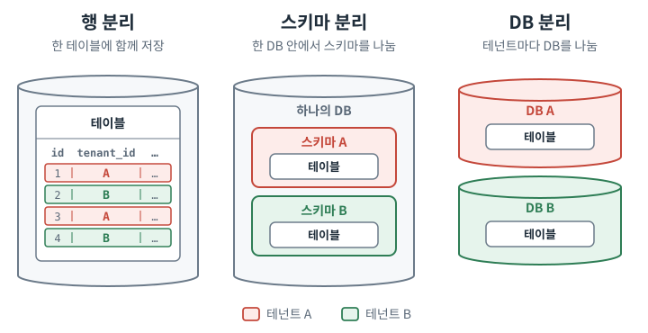

# Spring Boot와 JPA로 시작하는 데이터베이스 멀티테넌시

여러 고객사(테넌트)의 데이터를 하나의 테이블에서 관리하다 보면, Repository 메서드에 테넌트를 구분하는 `...AndTenantId`가 반복해서 등장합니다.

```java
interface OrderRepository extends JpaRepository<Order, Long> {
    Optional<Order> findByOrderIdAndTenantId(String orderId, String tenantId);

    List<Order> findAllByStatusAndTenantId(String status, String tenantId);

    long countByStatusAndTenantId(String status, String tenantId);
}
```

이 조건을 빠뜨리면 다른 고객사의 데이터가 섞여 나올 수 있습니다. 수정·삭제 쿼리라면 다른 고객사의 데이터를 바꾸거나 지울 수도 있습니다.

테넌트별로 스키마나 DB를 나누면 데이터를 구분하는 방식이 달라집니다. 쿼리마다 테넌트 조건을 넣는 대신, 애플리케이션에서 각 요청에 맞는 스키마나 DB를 사용하도록 구성합니다.

이 글에서는 두 방식을 Spring Boot와 JPA로 구현합니다. 엔티티와 Repository, 서비스 코드는 그대로 두고, 테넌트에 따라 조회·수정할 데이터가 어떻게 달라지는지 살펴봅니다.

> **예제 환경**
>
> Java 25 · Spring Boot 4.1.1 · Hibernate ORM 7.4.5.Final · PostgreSQL 17
>
> Spring Data JPA 등 의존성은 Spring Boot가 관리하는 버전을 사용했습니다.

> [!info] 코드 발췌 안내
> 예제는 동기 요청에서 JPA로 데이터를 조회하고 수정하는 흐름을 다룹니다. 본문에는 이 흐름을 설명하는 데 필요한 코드만 실었습니다.

## 테넌트와 데이터 분리 방식

멀티테넌시는 하나의 서비스를 여러 사용자 그룹이 함께 사용하는 아키텍처입니다. 이때 데이터를 나누는 기준이 되는 고객사나 조직을 테넌트라고 합니다. 한 테넌트에 여러 사용자가 속할 수도, 한 사용자가 여러 테넌트에 속할 수도 있습니다.[^tenant-membership] 따라서 사용자 ID와 테넌트 ID는 구분해야 합니다.

애플리케이션을 공유하더라도 테넌트의 데이터를 저장하는 구성은 달라질 수 있습니다. 관계형 DB에서 테넌트 데이터를 나누는 대표적인 단위는 행, 스키마, DB입니다.[^hibernate] 스키마는 DB 안에서 테이블 등의 객체를 묶는 네임스페이스입니다.



*색으로 칠한 영역이 테넌트를 나누는 단위입니다.*

| 방식                             | 데이터 배치                    | 조회 범위를 정하는 지점             |
| ------------------------------ | ------------------------- | ------------------------- |
| 행 단위 분리 (Discriminator column) | 같은 테이블에 여러 테넌트의 데이터를 저장   | SQL의 테넌트 조건 (`tenant_id`) |
| 스키마 분리 (Schema per tenant)     | 같은 DB 안의 테넌트별 스키마에 테이블 구성 | 커넥션에서 사용할 스키마             |
| DB 분리 (Database per tenant)    | 테넌트별 DB에 테이블 구성           | 커넥션을 얻을 DataSource        |

행 단위 분리에서도 모든 쿼리에 테넌트 조건을 직접 작성해야 하는 것은 아닙니다. Hibernate의 `@TenantId`로 테넌트 조건을 적용하거나, DB의 행 수준 보안(RLS) 정책으로 접근 가능한 행을 제한할 수 있습니다.[^hibernate][^postgres] 다만 조건을 자동으로 적용해도 여러 테넌트가 같은 테이블을 사용합니다. 테넌트별 데이터를 따로 옮기거나 관리해야 할 때 스키마·DB 분리를 고려합니다.[^azure-patterns] 예제에서는 이 두 방식을 각각 구현했습니다.

## 두 방식의 공통 예제

Marvel과 DC를 테넌트로 삼아 캐스팅 목록을 각각 준비했습니다. Ryan Reynolds의 배역은 Marvel에서는 `Deadpool`, DC에서는 `Green Lantern`입니다. 각 테넌트에는 배우당 하나의 배역을 저장하고, 배우 ID인 `actorSlug`를 테이블의 기본 키로 사용합니다.

| 세계관(테넌트) | 배우 ID (`actorSlug`) | 배역 (`characterName`) |
| --- | --- | --- |
| Marvel (`marvel`) | `ryan-reynolds` | Deadpool |
| DC (`dc`) | `ryan-reynolds` | Green Lantern |

같은 배우 ID로 조회했을 때 테넌트에 맞는 배역이 나오는지, Marvel의 배역명을 수정해도 DC의 배역명은 유지되는지 확인합니다.

DB와 스키마, 각 테넌트의 `casting` 테이블은 초기화 스크립트로 미리 만들었습니다. 두 방식 모두 다음 엔티티와 Repository를 사용합니다.

```java
// Casting.java
@Entity
@Table(name = "casting")
public class Casting {
    @Id
    @Column(name = "actor_slug")
    private String actorSlug;
    @Column(name = "character_name")
    private String characterName;
}

// CastingRepository.java
public interface CastingRepository extends JpaRepository<Casting, String> {}
```

서비스는 배우 ID로 엔티티를 조회하고, 수정 요청에서는 트랜잭션 안에서 배역명을 바꿉니다. 조회한 엔티티의 변경은 커밋 과정에서 DB에 반영되므로, 수정 메서드에서 `save()`를 따로 호출하지 않았습니다.

```java
@Service
public class CastingService {
    private final CastingRepository castings;

    @Transactional(readOnly = true)
    public CastingView findByActor(String actorSlug) {
        var casting = findCasting(actorSlug);
        return view(casting);
    }

    @Transactional
    public CastingView changeCharacterName(
            String actorSlug, String characterName) {
        var casting = findCasting(actorSlug);
        casting.changeCharacterName(characterName);
        return view(casting);
    }

    private Casting findCasting(String actorSlug) {
        return castings.findById(actorSlug)
                .orElseThrow(() -> new ResponseStatusException(HttpStatus.NOT_FOUND));
    }
}
```

조회·수정 메서드에는 테넌트 ID를 전달하지 않으며, Repository에도 테넌트 조건이 없습니다. 두 방식에서 이 코드를 그대로 사용하고, Hibernate가 테넌트에 맞는 스키마나 DataSource를 선택하는 부분을 다르게 구성했습니다.

구현은 `demo.strategy` 값에 따라 선택합니다. 공통 JPA 설정은 `application.yaml`에 두고, 방식별 설정은 두 파일로 나눴습니다. 실행할 때 `schema`·`database` 프로파일 중 하나를 활성화하면 해당 파일을 불러옵니다.

```yaml
# application.yaml
spring:
  jpa:
    open-in-view: false  # 요청 전체에 세션을 유지하지 않음
```

```yaml
# application-schema.yaml
demo:
  strategy: SCHEMA
  schema:
    url: jdbc:postgresql://localhost:55432/shared
    tenants:  # 테넌트 ID → 스키마 이름
      marvel: marvel_schema
      dc: dc_schema
```

```yaml
# application-database.yaml
demo:
  strategy: DATABASE
  database:
    metadata-url: jdbc:postgresql://localhost:55432/control
    datasources:
      marvel:
        url: jdbc:postgresql://localhost:55432/marvel_db
      dc:
        url: jdbc:postgresql://localhost:55432/dc_db
```

## 요청의 테넌트를 세션에 전달

서비스가 테넌트 ID를 받지 않아도 동작하려면, Hibernate가 어떤 테넌트의 데이터를 다루는지 알아야 합니다. 이 예제의 JPA `EntityManager`는 Hibernate의 `Session`을 기반으로 동작하며, 세션은 생성할 때 정한 테넌트를 계속 사용합니다.[^hibernate]

예제에서는 요청 전체에 `EntityManager`를 유지하는 OSIV(Open EntityManager in View)를 껐습니다. 이 상태에서 서비스를 호출하는 쪽에 트랜잭션(외부 트랜잭션)이 없으면, Spring이 주입한 `CastingService`의 트랜잭션 메서드를 호출할 때 새 세션이 열립니다.[^transactions] 따라서 테넌트는 서비스 호출 전에 정해 두어야 합니다. 서블릿 필터에서 `X-Tenant-Id` 헤더를 읽고, 요청 처리 범위에 테넌트 ID를 바인딩하도록 구성했습니다.


*세션을 열 때 테넌트를 정하고, 커넥션이 필요할 때 그 테넌트에 맞는 저장 위치를 선택합니다.*

### 요청 처리 중 테넌트 보관

요청에서 읽은 테넌트 ID는 테넌트 컨텍스트에 보관하고, 하위 호출에서 꺼내 쓰도록 했습니다. 서비스나 Repository 메서드마다 테넌트 ID를 인자로 전달하지 않아도 됩니다.

이런 테넌트 컨텍스트에는 흔히 `ThreadLocal`을 사용합니다. 이번 예제에서는 필터가 정한 테넌트 ID를 하위 호출에서 읽기만 하므로 Java 25의 `ScopedValue`를 선택했습니다.[^scoped-value] `TenantContext`는 이를 감싼 보조 클래스입니다.

```java
public final class TenantContext {
    private static final ScopedValue<String> CURRENT = ScopedValue.newInstance();

    // 지정한 테넌트를 바인딩한 범위에서 작업을 실행한다.
    public static <T> T call(String tenant, Supplier<T> work) {
        return ScopedValue.where(CURRENT, tenant).call(work::get);
    }

    public static <T, X extends Throwable> T callChecked(
        String tenant, ScopedValue.CallableOp<T, X> work
    ) throws X {
        return ScopedValue.where(CURRENT, tenant).call(work);
    }

    // 바인딩된 테넌트를 읽는다. 바인딩 범위 밖에서 호출하면 예외가 발생한다.
    public static String required() {
        if (!CURRENT.isBound()) {
            throw new IllegalStateException("No tenant is bound");
        }
        return CURRENT.get();
    }
}
```

`call()`과 `callChecked()`는 테넌트가 바인딩된 범위에서 작업을 실행합니다. 그 안에서는 `required()`로 테넌트 ID를 읽을 수 있으며, 실행 범위가 끝나면 바인딩이 해제됩니다.

> [!info] ThreadLocal과 ScopedValue 비교
>
> | 구분 | `ThreadLocal` | `ScopedValue` |
> | --- | --- | --- |
> | 값의 수명 | 직접 제거하거나 스레드가 끝날 때까지 유지 | 지정한 실행 범위가 끝날 때까지 유지 |
> | 종료 시 정리 | 보통 `finally`에서 `remove()` | 정상·예외 종료 시 바인딩 자동 해제 |
> | 중첩 범위 처리 | 이전 값을 직접 저장·복원 | 안쪽 범위 종료 후 이전 바인딩 복원 |
>
> `ThreadLocal`을 `ScopedValue`로 옮기고 서블릿 필터에 적용하는 과정은 넥스트리의 [컨텍스트 전파 리팩토링 영상 강좌](https://www.nextree.io/modeon-baegendeu-keontegseuteu-jeonpa-ripaegtoring-1/)에서 살펴볼 수 있습니다.

필터는 헤더에서 읽은 테넌트 ID를 바인딩하고, 그 범위 안에서 나머지 요청을 처리합니다. 필터 체인에서 발생하는 검사 예외를 전달하기 위해 `callChecked()`를 사용합니다.

```java
public class TenantFilter extends OncePerRequestFilter {
    @Override
    protected void doFilterInternal(
            HttpServletRequest request,
            HttpServletResponse response,
            FilterChain chain) throws IOException, ServletException {
        // 헤더 검증과 필터 체인의 예외 처리(try/catch)는 생략
        String tenant = request.getHeader("X-Tenant-Id");
        TenantContext.callChecked(tenant, () -> {
            chain.doFilter(request, response);  // 나머지 요청 처리는 이 바인딩 범위 안에서 실행된다.
            return null;
        });
    }
}
```

이 범위 안에서 서비스가 호출되면 Spring이 `@Transactional`에 따라 트랜잭션을 시작합니다. 이제 Hibernate가 새 세션을 열 때 테넌트 컨텍스트에서 ID를 읽도록 설정합니다.

### Hibernate에 테넌트 전달

Hibernate는 `CurrentTenantIdentifierResolver`로 새 세션에 사용할 테넌트 ID를 얻습니다.[^hibernate] 예제의 `TenantResolver`는 테넌트 컨텍스트에서 ID를 읽고, 설정에 등록된 값인지 확인한 뒤 반환합니다.

```java
public class TenantResolver implements CurrentTenantIdentifierResolver<String> {
    private final TenantProperties tenants;  // 설정의 demo 값

    @Override
    public String resolveCurrentTenantIdentifier() {
        String tenant = TenantContext.required();
        // 설정에 등록된 테넌트인지 확인한다.
        if (!tenants.knows(tenant)) {
            throw new IllegalArgumentException("Unknown tenant: " + tenant);
        }
        return tenant;
    }
}
```

새 세션을 열 때 테넌트가 바인딩되지 않았거나 바인딩된 ID가 설정에 없다면, 예외가 발생합니다.

Resolver는 Spring Boot의 `HibernatePropertiesCustomizer`를 통해 Hibernate 속성에 등록했습니다. 뒤에서 다룰 `TenantSchemaMapper`와 `MultiTenantConnectionProvider`도 같은 방식으로 등록합니다.

```java
@Configuration
public class TenantConfiguration {
    @Bean
    HibernatePropertiesCustomizer tenantIdentity(TenantResolver resolver) {
        return properties -> properties.put(
                MultiTenancySettings.MULTI_TENANT_IDENTIFIER_RESOLVER, resolver);
    }
}
```

`TenantResolver`는 `marvel`, `dc` 같은 테넌트 ID를 세션에 전달합니다. 이 ID에 맞는 스키마나 DataSource는 Hibernate가 커넥션을 얻을 때 선택합니다.

## 스키마 분리: 같은 DB에서 스키마 선택

스키마 분리에서는 하나의 DataSource로 `shared` DB에 연결하고, 테넌트에 따라 사용할 스키마를 바꿉니다. 앞의 Resolver가 테넌트 ID를 정하면, Hibernate 7.1부터 제공하는 `TenantSchemaMapper`가 그 ID에 대응하는 스키마 이름을 반환합니다.[^schema]

다음은 `TenantConfiguration`에서 스키마 분리에 해당하는 설정을 발췌한 코드입니다. `demo.schema.tenants`에 등록한 매핑을 사용합니다.

```java
@Configuration
public class TenantConfiguration {
    @Configuration
    @ConditionalOnProperty(
            prefix = "demo", name = "strategy", havingValue = "SCHEMA")
    static class Schema {
        @Bean
        TenantSchemaMapper<String> schemaMapper(TenantProperties properties) {
            return tenant -> {
                // demo.schema.tenants에서 테넌트 ID에 맞는 스키마 이름을 찾는다.
                String schema = properties.schema().tenants().get(tenant);
                if (schema == null) {
                    throw new IllegalArgumentException("Unknown tenant: " + tenant);
                }
                return schema;
            };
        }
    }
}
```

매퍼 빈은 같은 설정 클래스의 `HibernatePropertiesCustomizer`에서 다음 속성으로 등록합니다.

```java
properties.put(MultiTenancySettings.MULTI_TENANT_SCHEMA_MAPPER, mapper);
```

Hibernate는 커넥션을 얻을 때 세션의 테넌트 ID를 매퍼에 전달하고, 반환된 스키마 이름으로 `Connection.setSchema()`를 호출합니다.[^schema] 따라서 같은 코드로 `casting` 테이블을 조회해도 Marvel 세션에서는 `marvel_schema.casting`을, DC 세션에서는 `dc_schema.casting`을 읽습니다.

## DB 분리: 테넌트별 DataSource 선택

DB 분리에서는 테넌트별 DB에 연결하는 DataSource를 선택합니다. 애플리케이션을 시작할 때 `demo.database.datasources`의 접속 정보로 테넌트별 HikariCP 풀을 만들어 두었습니다.

Hibernate는 커넥션이 필요할 때 세션의 테넌트 ID를 `MultiTenantConnectionProvider`에 전달합니다.[^hibernate] 예제의 `Connections.Provider`는 Hibernate가 제공하는 추상 클래스를 상속하고, DataSource를 선택하는 메서드를 재정의합니다.

```java
public static final class Provider
        extends AbstractDataSourceBasedMultiTenantConnectionProviderImpl<String> {
    private final Catalog catalog;      // 테넌트별 풀을 보관하는 예제의 보조 객체
    private final DataSource metadata;  // control DB의 DataSource

    @Override
    protected DataSource selectDataSource(String tenant) {
        // 테넌트 컨텍스트를 다시 읽지 않고, 세션이 넘긴 테넌트 ID를 사용한다.
        return catalog.require(tenant);
    }

    @Override
    protected DataSource selectAnyDataSource() {
        // 애플리케이션 시작 시 메타데이터 조회처럼 테넌트가 정해지지 않았을 때 쓴다.
        return metadata;
    }
}
```

`selectDataSource()`는 세션이 전달한 테넌트 ID로 DataSource를 선택합니다. 한편 Hibernate가 테넌트 ID 없이 DB 종류·버전 같은 JDBC 메타데이터를 조회할 때 사용할 DataSource는 `selectAnyDataSource()`가 정합니다. 예제에서는 이 메서드가 업무 테이블이 없는 `control` DB의 DataSource를 반환합니다.

이 Provider도 `demo.strategy`가 `DATABASE`일 때 Spring 빈으로 만들고, `HibernatePropertiesCustomizer`에서 등록했습니다.

```java
properties.put(MultiTenancySettings.MULTI_TENANT_CONNECTION_PROVIDER, provider);
```

같은 `findById("ryan-reynolds")`를 호출해도 Marvel 세션은 `marvel_db`에서, DC 세션은 `dc_db`에서 배역을 읽습니다. Repository는 어떤 DataSource가 선택되었는지 알 필요가 없습니다.

## 테스트 코드로 조회·수정 확인

API를 호출할 때는 `X-Tenant-Id` 헤더로 테넌트를 지정합니다. Marvel의 배역을 조회하는 요청은 다음과 같습니다.

```bash
curl -s -H 'X-Tenant-Id: marvel' http://localhost:8080/castings/ryan-reynolds
# {"tenant":"marvel","actorSlug":"ryan-reynolds","characterName":"Deadpool"}
```

두 방식의 공통 통합 테스트에서는 서비스 메서드를 직접 호출했습니다. HTTP 요청에서 필터가 하던 바인딩은 `TenantContext.call()`로 수행합니다. 각 테스트를 시작하기 전에 Marvel의 배역은 `Deadpool`, DC의 배역은 `Green Lantern`으로 초기화하고, 외부 트랜잭션이 없는 상태에서 `CastingService`를 호출합니다.

```java
@SpringBootTest(webEnvironment = SpringBootTest.WebEnvironment.RANDOM_PORT)
abstract class TenantApiTest {
    @Autowired
    CastingService castingService;

    @Test
    void sameActorReturnsDifferentCharacters() {
        var marvelCasting = TenantContext.call("marvel", () ->
                castingService.findByActor("ryan-reynolds"));
        var dcCasting = TenantContext.call("dc", () ->
                castingService.findByActor("ryan-reynolds"));
        assertThat(marvelCasting.characterName()).isEqualTo("Deadpool");
        assertThat(dcCasting.characterName()).isEqualTo("Green Lantern");
    }

    @Test
    void characterNameChangeDoesNotAffectOtherTenant() {
        TenantContext.call("marvel", () ->
                castingService.changeCharacterName("ryan-reynolds", "Deadpool (updated)"));
        var marvelCasting = TenantContext.call("marvel", () ->
                castingService.findByActor("ryan-reynolds"));
        var dcCasting = TenantContext.call("dc", () ->
                castingService.findByActor("ryan-reynolds"));
        assertThat(marvelCasting.characterName()).isEqualTo("Deadpool (updated)");
        assertThat(dcCasting.characterName()).isEqualTo("Green Lantern");
    }
}
```

```java
@ActiveProfiles("schema")
class SchemaModeTest extends TenantApiTest {}

@ActiveProfiles("database")
class DatabaseModeTest extends TenantApiTest {}
```

두 방식에서 같은 조회·수정 테스트가 PostgreSQL 17에서 모두 통과했습니다.

스키마 분리에서는 커넥션을 재사용할 때도 테넌트에 맞는 배역이 조회되는지 확인했습니다. 커넥션을 반납한 뒤에는 스키마가 원래 값으로 복원됐습니다.

## 테넌트 전환과 트랜잭션 경계

앞의 테스트는 테넌트를 바인딩한 뒤 서비스를 각각 호출했습니다. 여러 테넌트의 데이터를 다루는 기능에서는 이 호출들을 하나의 메서드로 묶어야 할 경우도 있습니다. 예를 들어 운영자 화면에서 한 배우의 세계관별 배역을 함께 보여 주려면, Marvel과 DC의 조회 결과를 합쳐야 합니다.

이 작업을 하나의 `@Transactional` 메서드로 묶고 Marvel이 바인딩된 상태에서 호출하면, 트랜잭션은 Marvel 세션으로 시작합니다. 그 안에서 `TenantContext.call("dc", …)`로 DC를 바인딩하고 조회 서비스를 호출해도 새 세션은 열리지 않습니다. Spring의 기본 전파 속성인 `REQUIRED`에서는 안쪽 서비스가 기존 트랜잭션에 참여하기 때문입니다.[^transactions]

예제에서는 하나의 트랜잭션 메서드 안에서 Marvel로 조회한 뒤, 테넌트 컨텍스트만 DC로 바꿔 같은 배우를 다시 조회했습니다. DB 조회도 다시 실행됐고 예외는 발생하지 않았지만, 결과는 기대한 `Green Lantern`이 아니라 `Deadpool`이었습니다. 테넌트 컨텍스트의 값은 DC여도 이미 열린 세션은 Marvel을 계속 사용한 것입니다.

조회할 테넌트를 바꾸려면 새 세션이 열리기 전에 원하는 테넌트를 바인딩해야 합니다. OSIV를 끈 이 예제에서는 앞의 테스트처럼 외부 트랜잭션 없이 테넌트별로 서비스를 호출하면 됩니다. 각 호출이 끝난 뒤 결과를 합치는 방식으로 운영자 화면을 구성할 수 있습니다. 배치도 테넌트를 먼저 바인딩하고, 테넌트별 작업을 각각의 트랜잭션으로 실행하도록 구성할 수 있습니다.

> [!note] OSIV를 켠 경우
> Spring Boot는 웹 애플리케이션에서 OSIV를 기본으로 켜 두므로, 요청을 처리하는 동안 같은 `EntityManager`가 유지됩니다. 필터가 먼저 테넌트를 바인딩하므로, 예제처럼 요청 하나에서 테넌트 하나만 다루는 조회·수정은 OSIV를 켜도 동작합니다. 다만 요청 처리 중 테넌트 컨텍스트의 값을 바꾸면, 이미 열린 세션은 처음 테넌트를 계속 사용합니다.

## 운영에 적용하기 전에 확인할 것

예제에서는 두 테넌트의 스키마와 DB, 테이블을 미리 준비해 조회·수정 동작을 확인했습니다.

- **사용자 접근 권한:** 예제는 `X-Tenant-Id` 헤더에서 테넌트 ID를 읽고, 설정에 등록된 테넌트인지 확인합니다. 운영에서는 인증된 사용자가 해당 테넌트에 접근할 수 있는지, 요청한 작업을 수행할 권한이 있는지 확인해야 합니다.
- **DB 계정의 접근 범위:** 스키마 분리 예제는 같은 DB 계정으로 두 스키마에 접근합니다. 스키마 전환은 사용할 스키마를 정할 뿐, 계정이 다른 스키마에 접근할 권한까지 바꾸지는 않습니다.[^postgres] DB·스키마·테이블의 권한은 별도로 설정하고, 테넌트별 계정을 쓴다면 접속 정보와 풀 관리 방식도 함께 정해야 합니다.
- **테넌트 추가와 풀 수명:** 새 테넌트의 DB·스키마·테이블을 준비하고 애플리케이션 설정에 등록하는 절차가 필요합니다. DB 분리에서는 테넌트별 풀을 생성하고 종료하는 시점도 이 절차에 포함됩니다.
- **전체 커넥션 수:** DB 분리 예제는 테넌트마다 풀을 만듭니다. 테넌트 수와 애플리케이션 인스턴스 수, 각 풀의 크기를 함께 고려해 전체 커넥션 수를 산정하고 DB가 감당할 수 있는지 확인해야 합니다.
- **공유 자원의 부하:** 여러 테넌트가 같은 DB 인스턴스의 CPU·메모리·I/O를 공유하는 경우, 한 테넌트의 부하가 다른 테넌트에 미치는 영향을 살펴야 합니다.
- **테이블 구조 변경:** 테넌트마다 테이블을 두므로, 모든 테넌트에 마이그레이션을 적용할 순서와 일부 테넌트에서 실패했을 때 복구할 방법 등을 정해야 합니다.
- **백업·복구 단위:** 특정 테넌트만 복구할 수 있는지, 사용하는 DB 서비스의 복구 단위가 요구사항에 맞는지 확인해야 합니다.[^azure-patterns]
- **공용 데이터 조회:** 테넌트 데이터와 공용 데이터를 함께 읽는 기능이 필요하다면, 저장 위치에 맞는 조회 경로와 트랜잭션 구성을 정해야 합니다.

## 마치며

스키마 분리와 DB 분리 모두 엔티티와 Repository, 서비스 코드를 그대로 두고 테넌트별 데이터를 조회하고 수정할 수 있었습니다. 두 구현에서 달라진 것은 테넌트에 맞는 스키마나 DataSource를 선택하는 설정이었습니다.

테넌트 전달과 연결 선택을 공통으로 처리하면, 업무 코드마다 테넌트 조건을 반복하거나 데이터 분리 방식에 맞춰 조회·수정 코드를 바꾸는 부담을 줄일 수 있습니다.

[^tenant-membership]: Wonkook Lee, [테넌트·테넌시 개념과 싱글테넌시·멀티테넌시 비교](https://blog.wonkooklee.com/docs/software-design-and-theory/tenancy-fundamentals/). 사용자와 테넌트의 소속 관계.
[^hibernate]: Hibernate ORM, [A Short Guide to Hibernate 7: Multi-tenancy](https://docs.hibernate.org/orm/7.4/introduction/html_single/#multitenancy). 세 가지 분리 방식, `@TenantId`, 세션의 테넌트 지정과 Resolver·Provider의 역할.
[^postgres]: PostgreSQL 17, [Row Security Policies](https://www.postgresql.org/docs/17/ddl-rowsecurity.html), [Schemas](https://www.postgresql.org/docs/17/ddl-schemas.html). 행 접근 정책과 스키마별 접근 권한.
[^transactions]: Spring Boot, [SQL Databases](https://docs.spring.io/spring-boot/reference/data/sql.html)의 OSIV 설정; Spring Framework, [Transaction Propagation](https://docs.spring.io/spring-framework/reference/data-access/transaction/declarative/tx-propagation.html)의 `REQUIRED` 전파 동작.
[^scoped-value]: Oracle, [Java 25 ScopedValue](https://docs.oracle.com/en/java/javase/25/docs/api/java.base/java/lang/ScopedValue.html). 범위 바인딩과 중첩 범위 종료 시 이전 바인딩의 복원. Java 17/21 환경에서는 같은 역할을 `ThreadLocal`로 구현할 수 있습니다.
[^schema]: Hibernate ORM, [TenantSchemaMapper](https://docs.hibernate.org/orm/7.4/javadocs/org/hibernate/context/spi/TenantSchemaMapper.html), [MultiTenancySettings](https://docs.hibernate.org/orm/7.4/javadocs/org/hibernate/cfg/MultiTenancySettings.html#MULTI_TENANT_SCHEMA_MAPPER). 7.1 도입과 `@Incubating` 표시, 매퍼 등록에 따른 `Connection.setSchema()` 호출. Hibernate 7.1 이전에는 [`MultiTenantConnectionProvider`](https://docs.hibernate.org/orm/6.6/userguide/html_single/#multitenacy)에서 커넥션의 스키마 설정과 반납 시 복원을 처리하는 방식으로 구현할 수 있습니다.
[^azure-patterns]: Microsoft Learn, [다중 테넌트 SaaS 데이터베이스 테넌시 패턴](https://learn.microsoft.com/ko-kr/azure/azure-sql/database/saas-tenancy-app-design-patterns?view=azuresql). 테넌트별 복구와 운영 방식.
