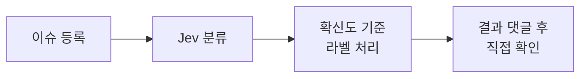

# Jev로 GitHub 이슈 분류하기

지난 글에서 TypeSafe AI가 만든 [[Jev와 System One 모델|Jev의 특징과 질문 타입]]을 알아봤다. 실제 기능에도 적용해 보고 싶어서 간단히 시험해 볼 대상으로 GitHub 이슈 분류를 골랐다. 사이트에서 오류나 의견을 GitHub 이슈로 등록하면 Jev가 제보의 종류와 관련 부분을 판단하고, 확신도가 높은 분류에만 봇이 라벨을 붙인다.

Jev는 문장을 생성하지 않고, 미리 정한 선택지마다 확률을 매겨 돌려준다. 오류인지 개선 제안인지, 어느 화면의 문제인지 고르고 그 결과에 따라 처리하는 일에 잘 맞을 것 같았다.

## 오류·의견 제보 폼

사이트에 `오류·의견 보내기` 링크를 달고 GitHub 이슈 폼으로 연결했다. 페이지 주소는 미리 채워 두고, 제보자는 무엇을 발견했는지(필수)와 어떻게 되면 좋을지(선택)를 적는다. 심각도나 종류, 관련 부분은 별도로 고르게 하지 않고 Jev에 맡겨 보기로 했다. 이렇게 하면 제보자가 [[운영자를 위한 분류가 사용자의 선택 부담을 늘릴 수 있다|사이트의 분류 기준까지 고민할 필요가 없어진다]].

![[blog-issue-toc.png|320]]

*목차에서 현재 읽는 부분의 제목은 굵게 표시되지만 왼쪽 강조 막대가 보이지 않았다. 목차 아래의 ‘오류·의견 보내기’로 이 문제를 직접 제보했다.*

![[blog-issue-form.png]]

*폼은 링크를 누른 페이지 주소를 미리 채우고, 제보가 공개 이슈로 남으며 TypeSafe의 분류 모델에 전달된다는 점을 먼저 알린다.*

폼으로 등록한 이슈에는 `needs-triage` 라벨이 붙는다. 내가 아직 확인하지 않은 제보라는 표시다.

## 분류 흐름과 라벨 기준

이슈가 등록되면 GitHub Actions가 실행되어 제목과 본문을 TypeSafe의 Jev API로 보낸다. 응답을 받으면 미리 정한 규칙에 따라 라벨을 붙이고, 처리 결과를 댓글로 남긴다.

*종류*와 *관련 부분*은 각각 선택지 중 하나를 고르는 질문이라, Jev의 질문 타입 가운데 **Choice**를 사용했다. 종류는 오류·내용 정정·개선 제안·질문·유지 보수 중에서 고르고, 관련 부분은 글 페이지·홈 화면·검색 등으로 나눴다. 적절한 답이 없을 때 등을 대비해  ‘해당 없음’과 ‘알 수 없음’도 각각 넣었다.

Choice는 고른 답과 함께 선택지별 확률과 확신도를 돌려준다. 확신도는 확률 분포에서 계산한 값으로, 확률이 한 선택지에 몰릴수록 높고 고르게 퍼질수록 낮다.[^confidence] 라벨은 **확신도가 0.9 이상일 때만** 붙이도록 초기 기준을 설정했다. ‘해당 없음’이나 ‘알 수 없음’은 확신도가 높아도 라벨을 붙이지 않는다.

댓글에는 Jev가 고른 답과 실제로 붙인 라벨을 나란히 적고, 확률과 확신도는 ‘자세히’를 펼쳐 필요시 확인할 수 있게 했다.

## 오류와 개선 제안의 구분

선택지에는 제보에서 확인할 수 있는 증상을 적었다. ‘설계대로 동작하지만 불편한 것’이라고만 쓰면, Jev는 제보만으로 원래 설계를 알 수 없기 때문이다.[^descriptions]

예를 들어 ‘버튼이 작아서 누르기 어렵다’는 개선 제안으로, ‘버튼을 눌러도 아무 반응이 없다’는 오류로 구분하려는 것이다.

## 직접 제보해 본 결과

다른 계정으로 두 문제를 직접 제보해 봤다.

첫 번째는 앞서 본 [목차의 강조 막대 문제](https://github.com/taez224/taez224.github.io/issues/49)였다. Jev는 종류로 ‘오류’를, 관련 부분으로 ‘글 페이지’를 골랐고 확신도는 각각 0.99와 1.00이었다. 둘 다 기준을 넘어 봇이 `bug`와 `area:reader`를 붙였다.

![[blog-issue-labels.png|560]]

*봇이 두 라벨을 붙이고 남긴 댓글. ‘자세히’에 확신도와 후보별 확률이 있다.*

두 번째는 휴대폰에서 [목차 버튼이 바닥글의 RSS 링크를 가리는 문제](https://github.com/taez224/taez224.github.io/issues/50)였다. Jev는 이번에도 ‘오류’와 ‘글 페이지’를 골랐지만, 붙은 라벨은 `area:reader` 하나였다. 관련 부분의 확신도는 0.91로 기준을 넘었다. 종류는 오류의 확률이 0.84였는데도 확신도가 0.80에 그쳤다. 나머지 0.16은 개선 제안이었다. 오류와 개선 제안 사이에서 확률이 나뉜 것이다.

> [!note]- 이슈와 자동 분류 댓글
> ![[blog-issue-test.png]]
>
> *‘현재 처리’ 칸에 종류는 보류로, 관련 부분은 `area:reader`로 남았다.*

보류된 종류는 내가 제보를 읽고 `bug`를 붙인 뒤 `needs-triage`를 뗐다. 자동으로 붙은 라벨이 있어도, [[생성은 AI에게, 검증은 나에게|내가 확인을 마치기 전까지는]] `needs-triage`가 남는다.

## 답과 함께 받는 확률

이슈 분류는 LLM으로도 할 수 있다. 다만 LLM에 확신도를 함께 달라고 하면 그 숫자도 모델이 생성한 답의 일부다. Jev는 선택지마다 확률을 계산해 돌려주고, TypeSafe는 Jev의 확신도가 보정되어 있어 높을수록 정확도도 높다고 밝힌다.[^announce] 그래서 ‘0.9 이상이면 라벨을 붙이고, 아니면 보류한다’처럼 그 숫자를 기준으로 코드가 처리를 나눌 수 있었다.

아직은 시험 제보 두 건으로 동작을 확인한 정도라, 0.9가 실제 제보에 맞는 기준인지는 데이터가 쌓여야 알 수 있다. 그래도 정해진 선택지 가운데 답을 고르고, 그 답을 바로 처리할지 사람에게 넘길지 나눠야 하는 일이라면 Jev를 써 볼 만하다고 느꼈다.

[^confidence]: TypeSafe AI, [Confidence](https://docs.typesafe.ai/confidence). 확신도를 선택지별 확률 분포에서 계산한 값으로 설명한다. 계산식은 공개하지 않는다.
[^descriptions]: taez224.github.io, [선택지 설명 수정 커밋](https://github.com/taez224/taez224.github.io/commit/3ba224a2dac4bf3c79af2adcd57343c5cfde49f8). 고치기 전과 후의 선택지 설명을 볼 수 있다.
[^announce]: TypeSafe AI, [Introducing System One Models & Jev](https://typesafe.ai/blog/introducing-system-one-models-and-jev). LLM은 확신도를 물어도 과신하고 일관되지 않은 값을 내기 쉽다고 지적하고, Jev의 확신도는 보정되어 높을수록 정확도도 높다고 설명한다.
